# Market Health Android UI/UX

[Final report and verification matrix](FINAL_UI_UX_REPORT.md) · [PR #514](https://github.com/chrisdudley-dev/market-health-cli/pull/514)

Financial logic and validated evidence are preserved. The new UI is for coordinator review; physical UI and natural battery acceptance remain open.

## Documentation

- [Ui Ux Design](UI_UX_DESIGN.md)
- [Information Architecture](INFORMATION_ARCHITECTURE.md)
- [Design System](DESIGN_SYSTEM.md)
- [Screen Redesign](SCREEN_REDESIGN.md)
- [Accessibility Audit](ACCESSIBILITY_AUDIT.md)
- [Responsive Layout](RESPONSIVE_LAYOUT.md)
- [Charts And History](CHARTS_AND_HISTORY.md)
- [Ui Test Results](UI_TEST_RESULTS.md)
- [Performance Results](PERFORMANCE_RESULTS.md)
- [Before After Summary](BEFORE_AFTER_SUMMARY.md)
- [Resume Reconciliation](RESUME_RECONCILIATION.md)

## Representative captures

Actual emulator Compose rendering; declared synthetic fixtures. See evidence/screenshots.json for hashes/profile/source.

| Screen | Light | Dark |
| --- | --- | --- |
| Dashboard | 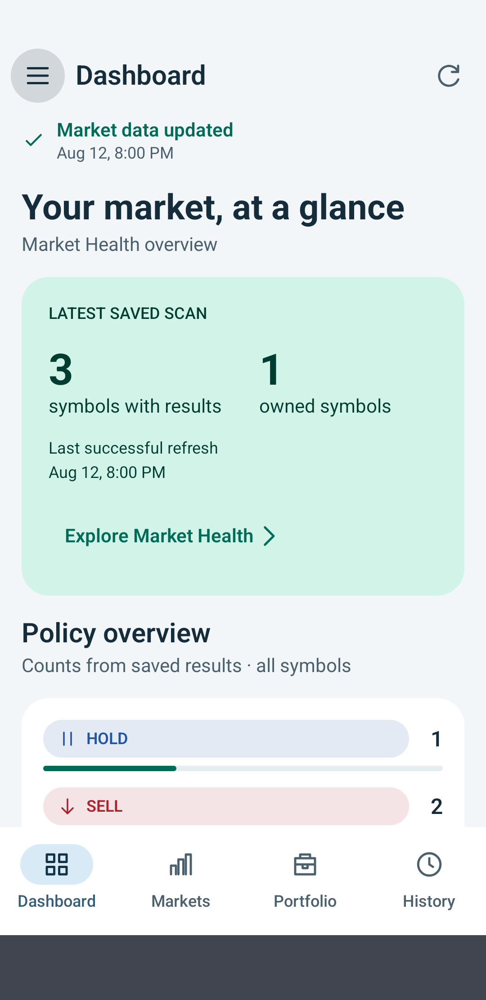 | 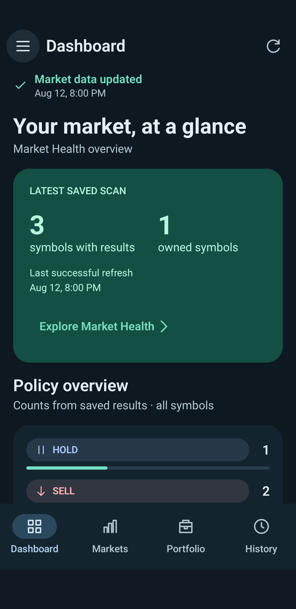 |
| Market Health | 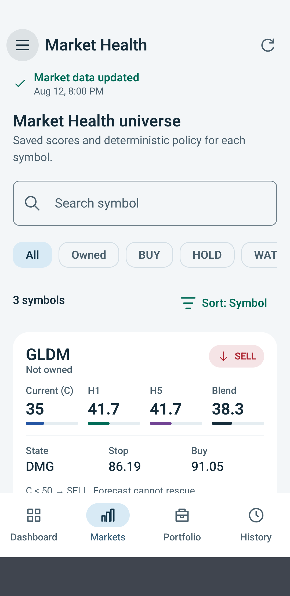 | 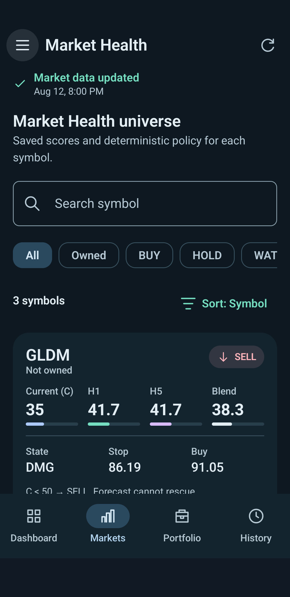 |
| Symbol detail | 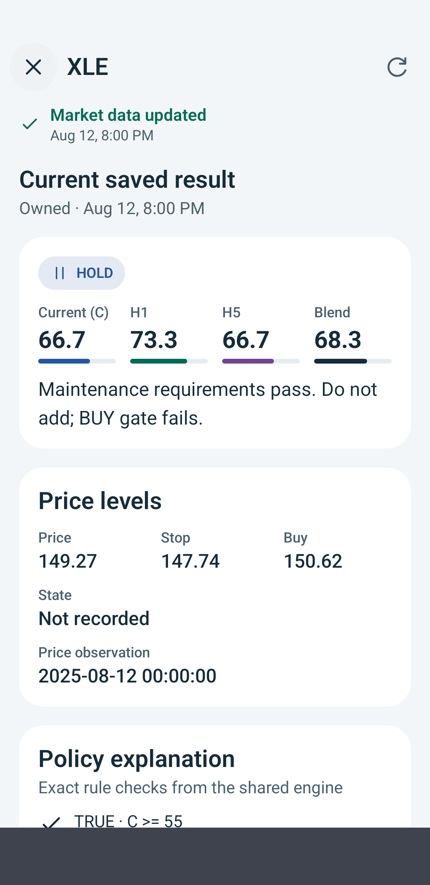 | 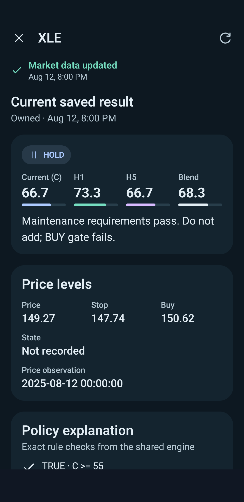 |
| Portfolio | 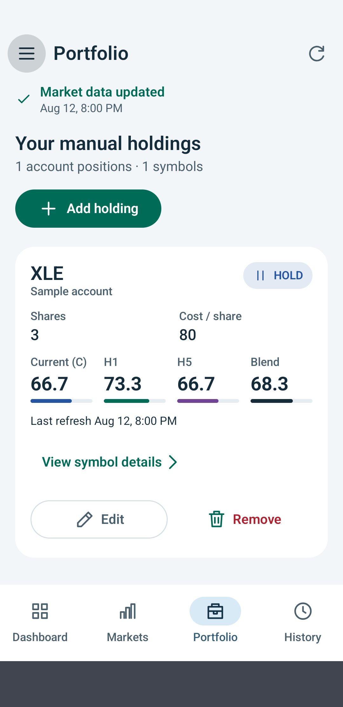 | 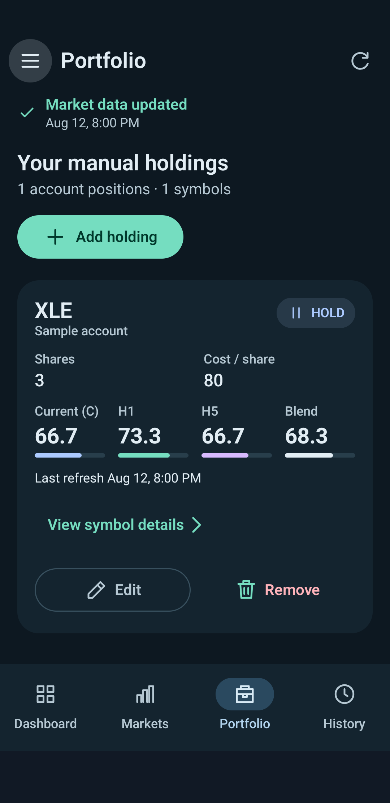 |
| History | 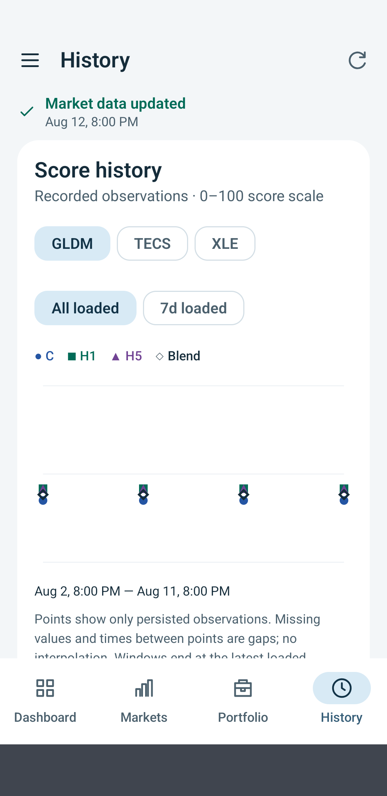 | 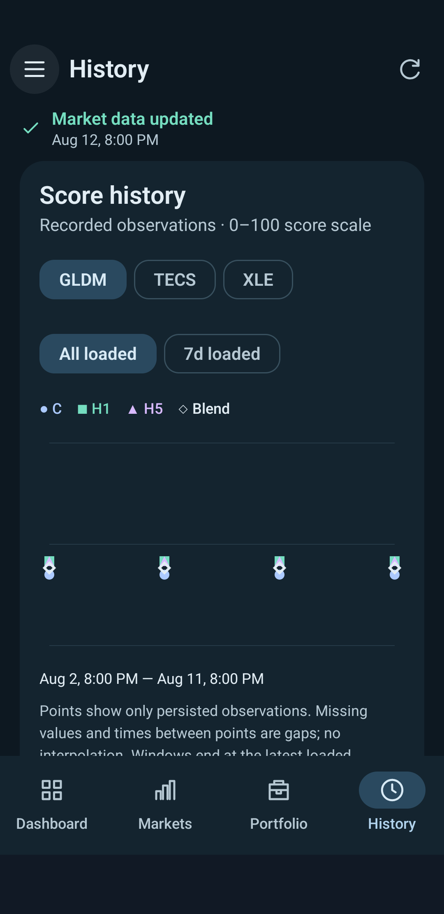 |
| Policy | 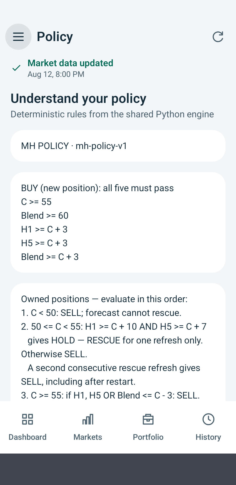 | 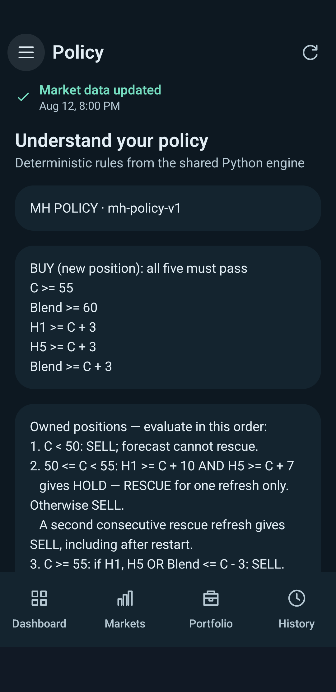 |
| Settings | 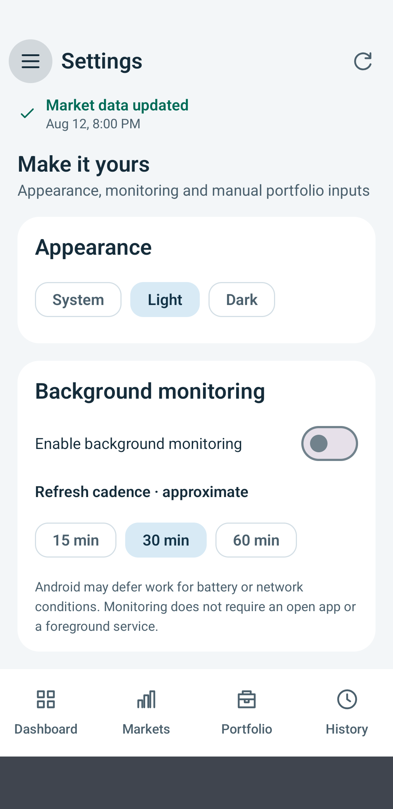 | 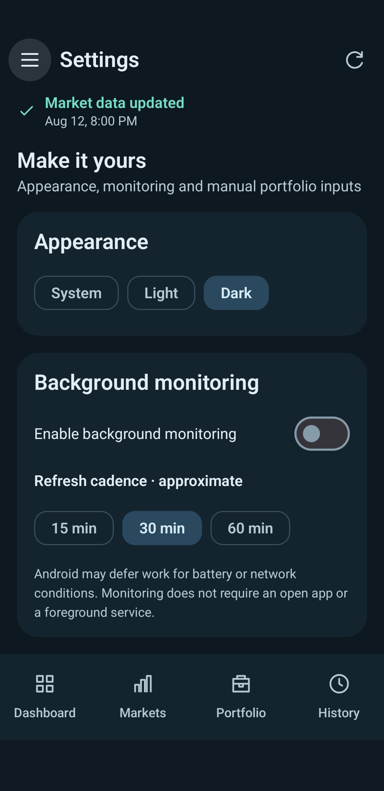 |
